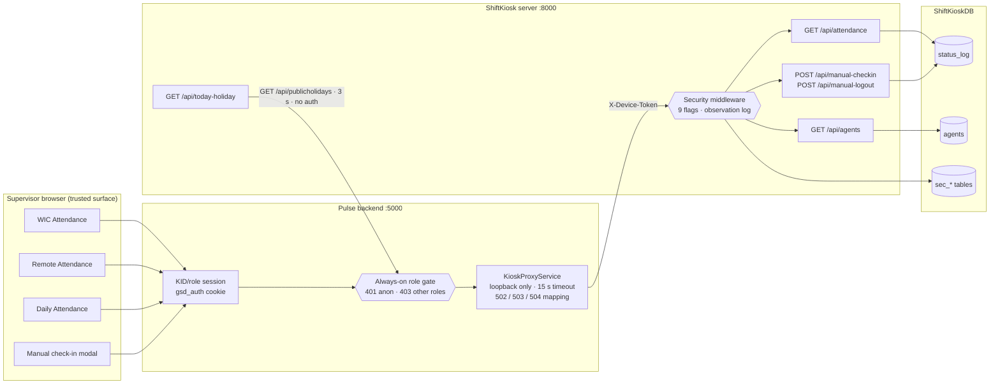
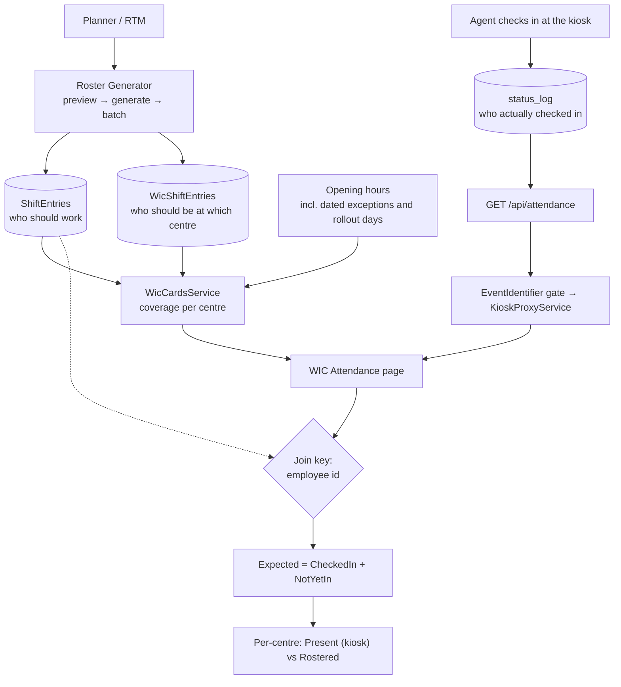

# INTEGRATION_AND_DATA_FLOWS — how the two systems talk

**Verification basis:** both repositories and both live databases, read **read-only** on **2026-10-11**.
Every path, header and status code below was read from the code, with the file cited.

**Related documents:** [SYSTEM_ARCHITECTURE.md](./SYSTEM_ARCHITECTURE.md) ·
[SHIFTKIOSK.md](./SHIFTKIOSK.md) · [SECURITY_MODEL.md](./SECURITY_MODEL.md) ·
[DATA_MODEL.md](./DATA_MODEL.md)

---

## 1. The three connections

There are exactly **three** integration points between the two products. Nothing else is shared.

| # | Direction | Path | Credential | Purpose |
|---|---|---|---|---|
| 1 | Pulse → kiosk | `GET /api/kiosk/attendance` on Pulse → `GET /api/attendance` on the kiosk server | service **device token**, server-side only | The attendance feed shown in Pulse |
| 2 | Pulse → kiosk | `GET /api/kiosk/agents`, `POST /api/kiosk/manual-checkin`, `POST /api/kiosk/manual-logout` | same service device token | The agent list and supervisor manual actions |
| 3 | kiosk → Pulse | `GET /api/publicholidays?year=` on Pulse | none (loopback, 3-second timeout) | The public-holiday banner and holiday logic on the kiosk |

There is **no** direct database sharing, no message queue, no shared credential, and no shared code.

> **What used to be there.** The Pulse frontend used to call the kiosk server **directly** from the
> browser through a configured kiosk URL. On **2026-10-11** no such call exists anywhere in the working
> tree: the environment variable that held it is not referenced by any page, and every kiosk call now
> goes through the Pulse proxy. This is verified, not assumed.

---

## 2. Pulse's authenticated kiosk proxy

**Frontend → Pulse.** Four surfaces in the SPA call these routes; the browser never learns the kiosk
address.

| Frontend call site | Pulse route | Proxied to the kiosk server |
|---|---|---|
| Daily Attendance, Remote Attendance, WIC Attendance (`GET /api/kiosk/attendance`) | `/api/kiosk/attendance` | `GET /api/attendance` with `date` and `tl` forwarded |
| Manual check-in modal (agent list) | `/api/kiosk/agents` | `GET /api/agents` |
| Manual check-in modal | `POST /api/kiosk/manual-checkin` | `POST /api/manual-checkin` |
| Manual check-in modal | `POST /api/kiosk/manual-logout` | `POST /api/manual-logout` |

**The gate on the Pulse side is always on**, independent of the global RBAC switch:

| Caller | Result |
|---|---|
| Anonymous | **401** JSON, before any outbound call |
| Authenticated `DEV`, `RTM`, `TEAM_LEAD` | The kiosk response is returned |
| Agent, unknown or missing role | **403** JSON |

The manual-action routes add three more conditions: the request must carry the same-origin marker
header, the `Origin` must match the host, and the acting identity must be non-empty (taken from the
session, never from the request body). A non-positive agent id is rejected as a bad request. Every
manual action writes a log line on the Pulse side as well as an audit row on the kiosk side.

**Configuration.** Three keys, names only: `Kiosk:BaseUrl`, `Kiosk:ServiceDeviceId`,
`Kiosk:ServiceToken`. The base URL must be an **absolute http loopback** address — a redirect or an
HTTPS upstream is refused at construction time. The credential values are never committed and are
never sent to a browser.

**Error mapping** (this is the part that makes failures visible instead of silent):

| Condition | Status |
|---|---|
| Token not configured | **503** with an explicit message |
| Upstream returned a non-success status | that status, forwarded verbatim with the upstream body |
| Feed is valid JSON but not an array, or a row is missing its identifier | **502** |
| Action response is not an object or does not report success | **502** |
| Malformed JSON | **502** |
| Timeout (15 seconds) | **504** |
| Network failure | **503** |
| Caller cancelled | the cancellation is propagated, not converted into an error body |

The reason this matters: an outage must never look like "everybody is absent". A failure to reach the
kiosk produces an error status the page can show, not an empty list.

---

## 3. The kiosk server's outbound call to Pulse

One endpoint, `GET /api/today-holiday`, fetches the national holiday calendar:

- base URL from the server configuration key `holiday_source_url`, default `http://localhost:5000`,
  with any trailing slash removed;
- request: `GET <base>/api/publicholidays?year=<year>` with a **3-second timeout**, executed off the
  event loop so it cannot block the server;
- no credential, no retry;
- fallback: if the base URL is empty the endpoint returns an empty list; on any exception it logs a
  warning and returns "not a holiday" rather than failing.

**Dependency direction worth noting:** this makes Pulse a soft dependency of the kiosk server's
holiday banner. The kiosk attendance path itself is unaffected — an unreachable Pulse degrades only
the holiday banner.

---

## 4. Diagram — the full integration picture



---

## 5. The roster → Pulse → kiosk flow, with the join explained



**The join rule, stated exactly.** The two systems are matched **only** on the employee identifier.
The kiosk's own free-text location field is shown to the user but is never parsed, normalised,
compared, matched or counted. This rule exists because an earlier version matched on a location
substring and attributed people to centres they were merely *assigned* to rather than working at.
Where an agent is working **from** comes from the work-mode value the agent chooses at check-in
(on-site at a centre, or the virtual/home-office mode).

**The counting identity** that makes the page's three numbers trustworthy:

```
CheckedIn = every distinct employee with a kiosk ACTIVE or DONE row today
Expected  = today's WIC roster at open centres (absences and back-office excluded)
            PLUS everyone who checked in and is not on that roster
NotYetIn  = Expected minus CheckedIn

 ⇒ Expected = CheckedIn + NotYetIn, unconditionally
```

DONE still counts as "checked in today". A kiosk row with a blank employee identifier is excluded from
every count and surfaced once as a note. A per-centre view names the two systems separately
("Present (kiosk) N · Rostered M") and flags the difference **in both directions**, so neither
"present but not rostered" nor "rostered but not present" is hidden.

---

## 6. Notification flows

### Pulse

Pulse sends no notifications of its own. Everything user-facing is in the application, and the
assistant is entirely local — **no external AI service is called**.

### ShiftKiosk

| Channel | Trigger | Notes |
|---|---|---|
| Teams adaptive card | Configurable per status | On-shift is off by default; sick leave is on by default; off, emergency and auto-logout are **hard-coded on** and ignore the configuration key that appears to control "off" |
| SMTP e-mail | Same trigger map | HTML table built from the event |
| Emergency acknowledgement | Always attempts a Teams card | Bypasses the normal trigger map and sends **no** e-mail |

Delivery is asynchronous and independent: each channel's failure only flips its own flag on the stored
event and is logged; it never affects the response to the agent's kiosk.

**Two honest observations:**

1. The notification payload is interpolated into HTML **without escaping**, so a free-text note
   containing markup ends up as markup in the e-mail body. An agent can therefore influence the
   rendering of a notification e-mail.
2. At the last recorded live state the notification flags were disabled. Enabling them is a
   personal-data transfer (sickness status leaves the system) and must be treated as such.

### A cross-system verification call that is documented but has no caller

The kiosk server exposes an endpoint whose documented purpose is to let **Pulse** verify a supervisor
credential server-to-server. The endpoint exists. The class it names as its caller —
`Backend/Services/SupervisorAuthClient.cs` — **does not exist in the Pulse repository**, and no Pulse
configuration key selects a supervisor mode. The integration is therefore one-sided: the kiosk can
verify a credential, but nothing in Pulse asks it to.

This matters for the data-flow picture in one specific way: **no Pulse session is ever derived from a
kiosk credential today.** Pulse identity comes only from its own KID lookup. The documented
"one implementation of password hashing, TOTP and lockout rather than two" is a design intention, not
a description of the running system. See [SECURITY_MODEL.md](./SECURITY_MODEL.md) §4 and
[OPEN_ITEMS_AND_RISKS.md](./OPEN_ITEMS_AND_RISKS.md) item **S14**.

---

## 7. All data flows, summarised

| Flow | Direction | Transport | Frequency | Failure behaviour |
|---|---|---|---|---|
| Attendance events | agent kiosk → kiosk server | HTTPS POST through the SYSTEM broker (NG) or direct (legacy) | per event | queued and retried; the NG queue is ordered and capped |
| Status resume check | agent kiosk → kiosk server | HTTPS GET | at client start | client proceeds to Phase 1 |
| Attendance read for Pulse | Pulse → kiosk server | loopback HTTP, service device token | on page view, then every 60 s | 502/503/504 surfaced to the page; never an empty success |
| Supervisor manual action | browser → Pulse → kiosk server | same proxy | on demand | refused locally if the session, origin or actor is missing |
| Public holidays | kiosk server → Pulse | loopback HTTP, 3-second timeout | on the holiday endpoint | returns "not a holiday" and logs |
| Live dashboard push | kiosk server → supervisor browser | WebSocket, 60-second REST fallback | continuous | polling fallback |
| Shift and roster writes | browser → Pulse | same-origin REST with the session cookie | on demand | validated and guarded; manual rows protected |
| Leave propagation | Pulse service layer | in-process | on create/edit/delete | writes and reverts shift rows |
| Exports | browser → Pulse | same-origin download | on demand | single-language headers |
| Observation | kiosk server → its own database | buffered in memory, flushed every 5 s or 500 rows | continuous | on a database failure the oldest rows are dropped and a counter increments |

---

## 8. What is *not* integrated (and should not be implied)

- **No HR, SAP, SharePoint or WFM connection.** There is no live external data feed in either
  repository. Files are brought in by hand or by scripts that live outside the application.
- **No single sign-on.** Pulse uses its own KID login; the kiosk dashboard uses its own supervisor
  cookie; the two do not trust each other's sessions.
- **No shared employee master.** The kiosk keeps its own `agents` table. Identifier drift between the
  two is possible and is a known operational risk.
- **No cross-system transaction.** An attendance event and a shift row are never committed together;
  the attendance page reconciles them at read time.
- **No alerting between the systems.** A kiosk outage surfaces in Pulse as an error status on the
  attendance page, not as a notification.
