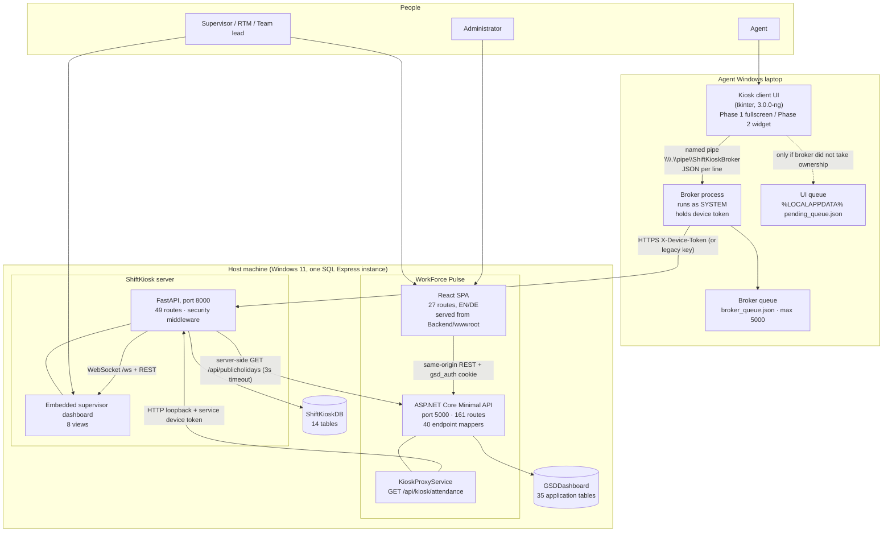
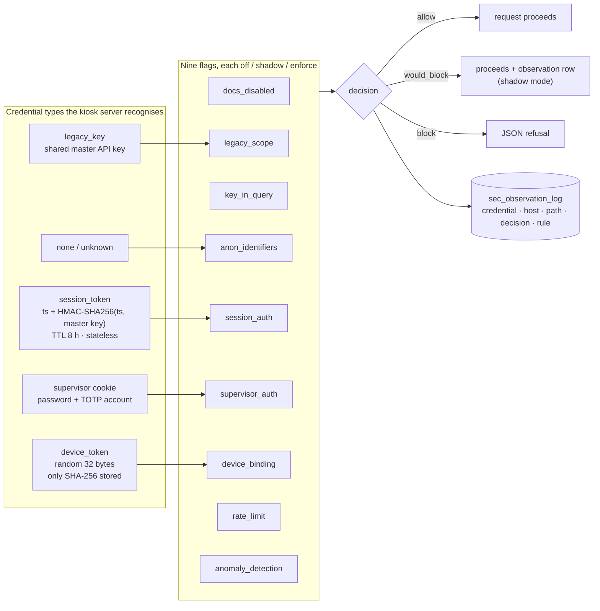
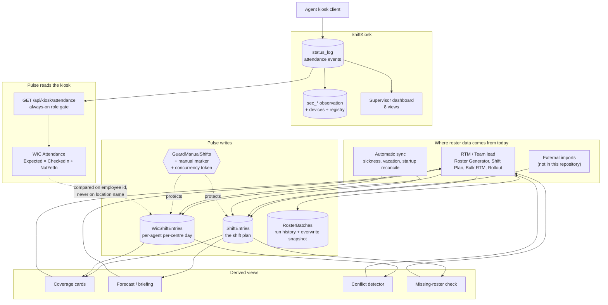
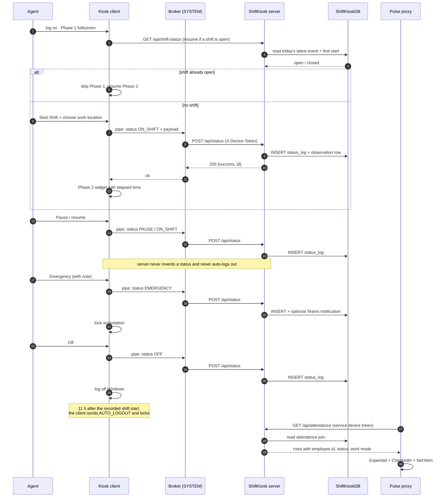

# SYSTEM_ARCHITECTURE — how the whole thing fits together

**Verification basis:** both repositories and both live databases, read **read-only** on **2026-10-11**.
Every structural claim cites a file, a route count, or a live-database fact.

**Related documents:** [PULSE_FEATURES.md](./PULSE_FEATURES.md) · [SHIFTKIOSK.md](./SHIFTKIOSK.md) ·
[INTEGRATION_AND_DATA_FLOWS.md](./INTEGRATION_AND_DATA_FLOWS.md) ·
[DATA_MODEL.md](./DATA_MODEL.md) · [SECURITY_MODEL.md](./SECURITY_MODEL.md) ·
[OPERATIONS.md](./OPERATIONS.md)

---

## 1. The system in one view

There are **two products and two repositories**, both running on the same Windows machine, side by
side, sharing one SQL Server Express instance but **not** sharing a database.

| | **WorkForce Pulse** | **ShiftKiosk** |
|---|---|---|
| What it is | The workforce-management and visibility application | The attendance-capture system |
| Repository | `C:\GSDDashboard_secure` | `C:\ShiftKiosk_secure` |
| Live deployment folder | `C:\GSDDashboard` (a separate, older checkout) | `C:\ShiftKiosk` |
| Backend | ASP.NET Core Minimal API, port **5000** | Python FastAPI + uvicorn, port **8000** |
| Frontend | React 19 + TypeScript, served from the backend at `/` | Server-rendered HTML embedded in the server file, at `/dashboard` |
| Database | `GSDDashboard` | `ShiftKioskDB` |
| Users | Team leads, RTM, planning, administrators | Agents (on their own laptops), supervisors |
| Namespace retained | `GSDDashboard.API` — the mismatch with "WorkForce Pulse" is deliberate | — |

Both ports are published externally through Microsoft Dev Tunnels, which expire and are restarted by
scheduled tasks.

### Diagram 1 — the whole architecture

**Reading the diagram.** Only three arrows cross between the two products, and they matter:
the broker calling the kiosk server (attendance writes), Pulse's proxy calling the kiosk server
(attendance reads), and the kiosk server making one outbound call to Pulse for the public-holiday
calendar. Nothing else is shared — not the database, not the credentials, not the code.

---

## 2. WorkForce Pulse — structure

### 2.1 Layers

| Layer | Technology | Where | Notes |
|---|---|---|---|
| Presentation | React 19, TypeScript, Vite, TanStack Query, Tailwind | `Frontend/src` | One page file per route; 27 routes registered |
| API | ASP.NET Core 8 Minimal API | `Backend` | **161 routes**, all registered by 40 mapper extension methods called in sequence from `Program.cs:683-722` |
| Domain services | C# service classes | `Backend/Services`, `Backend/Modules`, `Backend/Assistant`, top-level `*Service.cs` | 60+ classes; the only provably dead class is `CoverageCalculatorTests` |
| Data access | EF Core 8 against SQL Server Express | `Backend/GSDContext.cs` | No EF migrations — idempotent DDL blocks in `Program.cs` are the migration strategy |
| Database | SQL Server Express 2022 | `GSDDashboard` | 52 physical tables: 35 functional + 17 archive copies |
| Static hosting | The API serves the built SPA from `Backend/wwwroot` | — | Content-hashed assets cached forever; `index.html` never cached |

### 2.2 Request path

`Program.cs` composes the pipeline in this order, and the order is load-bearing:

1. Exception handler → a generic JSON 500.
2. **Swagger gate** — any path starting `/swagger` requires an authenticated `DEV` session,
   otherwise **404** (not 401), so the endpoint map is not disclosed. This gate is always on.
3. CORS → rate limiter → authentication → authorization → **RBAC middleware** → default files →
   static files → endpoint mappings → `/health` → single-page-app fallback.
4. After startup: a vacation reconciliation pass runs once before the server begins serving.

Two gates behave differently from the rest and must not be confused with the global switch:

- **`Auth:EnforceAuthorization`** controls only the general RBAC middleware. It is `false` today,
  which makes that middleware a no-op.
- **The always-on gates** are independent of it: `/api/roster/*` (RTM/TEAM_LEAD/DEV),
  `/api/kiosk/*` (authenticated DEV/RTM/TEAM_LEAD), `/swagger` (DEV), and the in-handler
  manual-edit gate on the shift-write routes.

### 2.3 Endpoint map by area

| Area | Prefix | Example capability |
|---|---|---|
| Auth | `/api/auth` | KID login, logout, who-am-I |
| Kiosk proxy | `/api/kiosk` | Attendance feed, agent list, supervisor manual check-in/log-out |
| Shifts | `/api/shifts` | Grid read, coverage, validation, assign (bulk / manual), swap, export |
| WIC | `/api/wic`, `/api/wic-coverage`, `/api/wicschedule` | Shift board, cards, forecast, substitutes, briefing, conflicts, assignment directory, opening-hours versions |
| VWIC | `/api/vwic` | Daily virtual coverage, rotation plans |
| Roster | `/api/roster` | Preview, generate, batches, delete-with-restore, missing-roster check, coverage walk |
| Absence | `/api/sickleave`, `/api/vacations`, `/api/albalance`, `/api/alcalendar` | CRUD plus shift synchronisation |
| People | `/api/employees` | CRUD, future shifts, timeline, AL balance edits |
| Lists and tools | `/api/bo-list`, `/api/rtm`, `/api/rollout`, `/api/pipeline`, `/api/training`, `/api/breaks` | Back-office list, bulk RTM, rollout days, pipeline events, training, break planning |
| Reporting | `/api/hr-export`, `/api/*/download` | The central HR export plus per-page exports |
| Assistant | `/api/assistant`, `/api/wic-assistant` | Internal question answering — no external AI service |
| Admin | `/api/admin` | DEV-only maintenance: demo-data delete, WIC orphan cleanup, WIC migration dry-run |
| Health | `/health` | Anonymous, for the watchdog |

### 2.4 Deployment reality (stated, not idealised)

| Fact | Detail |
|---|---|
| The running binary was built with .NET SDK **10.0.204** | The repository targets .NET 8 and cannot reproduce the live binary 1:1 with SDK 8 |
| The build source is the **working tree**, not `git HEAD` | `HEAD` can lag what is deployed; `C:\GSDDashboard` is a *separate* repo with older sources |
| The watchdog is the only thing allowed to start the executable | A deploy pauses it with a sentinel file, copies, verifies, then removes the sentinel |
| `/health` returning 200 is not evidence | It answers before the database, the proxy and the authenticated routes are proven |
| Frontend changes only count when served from port 5000 | Verifying on the Vite dev server proves nothing about what the user sees |

---

## 3. ShiftKiosk — structure

| Component | Detail |
|---|---|
| Server | One large FastAPI module plus a `server/security` package (`core`, `store`, `accounts`, `crypto`, `flags`) |
| Routes | **49** registered: 41 on the server object, 8 mounted by the security layer (sign-in, flags, login page) |
| Runtime | 32-bit Python, because the ODBC driver is 32-bit |
| Database access | `pyodbc` with Windows authentication; each helper opens and closes its own connection |
| Supervisor UI | HTML/CSS/JavaScript embedded as a string in the server file — no build step, no external assets |
| Security model | A middleware that classifies the caller's credential, evaluates nine named flags, and writes an observation row for every request |
| Clients | Legacy `2.1.1` (shared key) and NG `3.0.0-ng` (per-computer device token via a SYSTEM broker) |
| Auto-logout | 11 hours from shift start, enforced by the client, not the server |

### Diagram 2 — the identity and device model

**What the diagram is saying.** Every request is labelled with one of five credential kinds, checked
against nine rules, and given one of three verdicts. In shadow mode a rule records "would have
blocked" and lets the request through — that is how the operator decides when a rule is safe to
enforce. Four rules block by default; five observe only.

---

## 4. Diagram 3 — the roster → Pulse → kiosk data flow

**Key point for the board.** The two halves meet at exactly one place: the employee identifier.
Pulse decides who *should* be somewhere from its own roster tables; the kiosk records who actually
checked in; Pulse's WIC Attendance page joins the two on the employee id and shows the difference in
both directions. The kiosk's own free-text location field is displayed but deliberately never used in
that comparison.

---

## 5. Diagram 4 — one shift, end to end

**Where the queue fits.** Every arrow from the client to the server can fail. The legacy client writes
the event to a JSON queue and retries every 30 seconds; the NG client hands the event to the SYSTEM
broker, which owns a durable ordered queue with exponential back-off and a 5,000-event cap. The
server stores an event without an idempotency key, so an ambiguous failure can duplicate a row — the
Newest-row-wins rule means this affects history, not the current status.

---

## 6. Cross-cutting concerns

| Concern | Position |
|---|---|
| **Language** | EN/DE only, in both products. The permanent rule lives in `CLAUDE.md` (Pulse) and in the ShiftKiosk documentation; internal status codes and product names (WIC, VWIC, BO, Voice, GSD, RTM, KID) are never translated. Compliance is **incomplete** in Pulse — see [PULSE_FEATURES.md](./PULSE_FEATURES.md) §5. |
| **Real-time** | Pulse has **no WebSocket at all** and polls (60 s for kiosk data, 30 s for WIC Shifts and breaks, 10 min for the forecast). The kiosk dashboard does use a WebSocket with a 60-second polling fallback. |
| **Manual edits** | A manual marker plus a save-time guard plus concurrency tokens. If any automatic writer misses its check, the guard throws instead of silently overwriting. Full rules in [ROSTER_AND_SCHEDULING.md](./ROSTER_AND_SCHEDULING.md). |
| **Reversibility** | Roster batches snapshot what they overwrite; the deploy keeps code/config/import rollback snapshots; flag, code, schema and application rollbacks are four separate operations. |
| **Observability** | A watchdog per service, an independent 5-minute health check per port, an append-only deploy sentinel, and — on the kiosk side — a per-request observation log of 282,745 rows. |
| **Backup** | SQL backups to the instance's default folder, verified; a database backup is not the same as a code snapshot and neither is a rollback. |

---

## 7. Known architectural risks

1. **Version drift between repository and deployment.** The live binary comes from a different SDK
   and from the working tree; `HEAD` does not prove what is running. Any parity claim must be verified
   against the running artefact, not the source.
2. **Two repositories, one documentation set with holes.** Several kiosk-source comments point at
   `documentation/` files that exist only in the Pulse repository. Until that is fixed, a reader
   inside the kiosk repository cannot follow the references.
3. **Anonymous read path on the kiosk server.** The session token that the kiosk dashboard needs is
   issued without authentication, and it can still read history, audit and exports. Closing it is the
   remaining `dan3` step, not a completed control.
4. **A shared legacy key with roughly sixty dependants.** The retirement criterion is "no legacy
   inventory for 30 days", and the legacy clients are still sending events.
5. **Archive tables inside the live database.** 17 of the 52 tables are point-in-time copies with no
   documented retention. Any statement of "how many tables" must say which count it means.
6. **Session-optional manual stamping.** Three WIC write routes and the rollout routes fall back to a
   fixed actor tag when the session carries no KID, so while the global RBAC flag is off they have no
   401/403 and every caller is stamped as a human.
7. **The `PostalCode`/`City`/`Bundesland` chain and the location-name joins are string-based.** There
   is no foreign key between the WIC assignment table and the employee table; a rename silently
   orphans an assignment.
